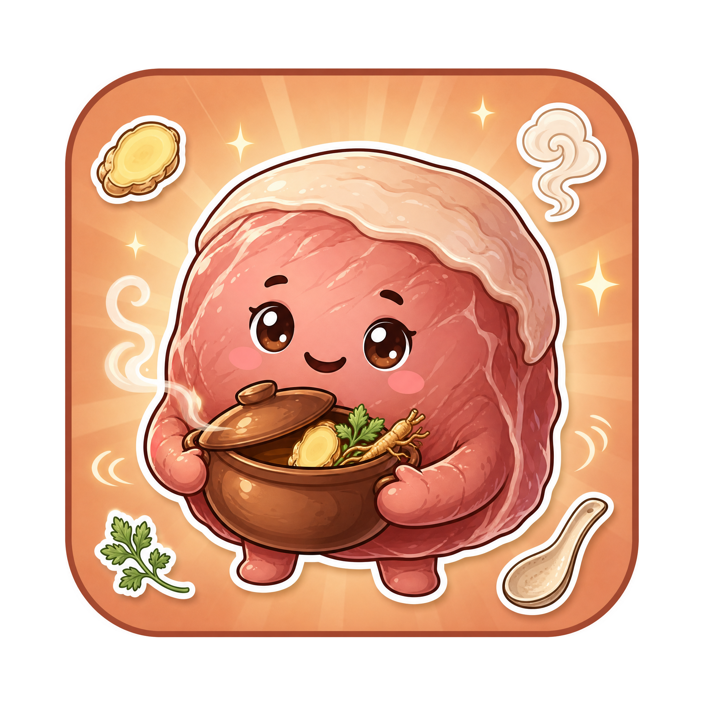

💊 **適用症狀**：小腹冷痛、經期前後或產後肚子冷痛、熱敷按著會好一點、經血色暗偏淡量不多、臉色蒼白唇色淡、手腳冰冷、容易頭暈、整個人沒力、舌淡苔白、脈沉細

> 📖 **方劑出處**：《金匱要略》（東漢・張仲景）——原文出現兩次。一次在寒疝篇：「**寒疝腹中痛，及脅痛裡急者，當歸生薑羊肉湯主之。**」一次在婦人產後篇：「**產後腹中㽲痛，當歸生薑羊肉湯主之；並治腹中寒疝，虛勞不足。**」
> 🏥 **方名含義**：三味藥，名字就是配方。它是中醫史上最早、也最有名的「**藥膳**」之一——仲景把一鍋湯寫進了醫書。

---

## 📖 「我不要再喝藥了，我已經看你喝兩個月了」

大雪前兩天，新竹的清晨降到十度。

承翰的 **[附子理中湯](/stories/fu-zi-li-zhong-tang/)** 喝了三週，清晨腹瀉停了，手腳暖回來。他回家那天晚上，發現太太佳蓉窩在沙發上，抱著熱水袋，臉色白得不像話。

「妳怎麼了？」

「老樣子，第二天。」

佳蓉三十三歲，高中國文老師。承翰這才知道，她**每個月生理期頭兩天都是這樣**，只是以前他自己拉肚子，沒注意：

- **小腹冷痛**，她形容「像有人拿冰袋壓在肚子上」
- **熱水袋壓著、手按著會好一點**，拿開又來
- **經血顏色暗、偏淡，量不多**，第一天幾乎只有一點點
- **臉色白、嘴唇沒血色**，同事問她是不是沒睡
- **手腳冰**，冬天上課要握著保溫杯
- **頭暈**，站太久會眼前發黑
- **整個人沒力**，第一天回家就躺
- 平常**不太怕熱**，吃冰的會更痛
- 止痛藥吃了有時候壓得住、有時候壓不住

「妳去看一下我那個中醫師。」

「我不要。」佳蓉說，「我已經看你喝兩個月了，我不想再喝藥。」

承翰想了想：「那妳去問，不一定要領藥。」

中醫師看了佳蓉的舌頭——**淡、苔白**——搭了脈，**沉而細**。問了經期、問了平常的飲食、問了手腳。然後問她：「妳會下廚嗎？」

「會。」

「那妳這週不領藥，」中醫師說，「**領一張菜單。**」

---

## 🩺 中醫師的診斷：血虛有寒，鍋裡沒湯底還一直開火

「妳這是**血虛，而且有寒**。」

「跟我先生一樣嗎？他也是怕冷。」

「不一樣。承翰是**陽虛**——火不夠，所以冷、所以拉肚子。妳是**血不夠，然後寒進來**。」中醫師想了一下怎麼講，「這樣說好了：妳是一鍋**沒放湯底的鍋**，一直在開火。」

「什麼意思？」

「血是湯底。湯底夠，火燒下去是熱湯；湯底不夠，火燒下去是**乾燒**——鍋會冷、會痛、會抖。妳的臉色白、唇淡、頭暈、經血少，是**湯底不夠**；小腹冷痛、手腳冰、熱敷會好，是**寒進來了**。」

他一項一項對回去：

- **經血少、色淡** = 血虛，沒有足夠的血可以排
- **臉白、唇淡、頭暈** = 血虛，供不到臉和頭
- **小腹冷痛、喜溫喜按** = 寒凝，血虛的地方最容易被寒鑽進去；按著舒服，表示是虛不是實
- **手腳冰** = 血虛加寒，送不到末端
- **舌淡苔白、脈沉細** = 血虛有寒的標準舌脈

「那為什麼不開藥？」

「因為妳的問題是**湯底不夠**。」中醫師說，「補血這件事，藥可以補，但**食物補得更穩、更久**——尤其是**血肉有情之品**。張仲景一千八百年前就知道這件事，所以他把一鍋羊肉湯寫進醫書裡。」

> **血虛** = 鍋裡沒有湯底（臉白、唇淡、頭暈、經血少）
> **有寒** = 鍋是冷的（小腹冷痛、手腳冰、熱敷會好）
> **處理** = 先加湯底（當歸、羊肉），再把鍋燒暖（生薑）

---

## 🌿 仲景寫進醫書的那鍋湯

《金匱要略》裡的方，絕大多數是草根樹皮。這一帖不一樣：

原方：**當歸三兩、生薑五兩、羊肉一斤**。

> 三味，以水八升，煮取三升，溫服七合，日三服。

仲景還在後面補了兩句：

> 若寒多者，加生薑成一斤；痛多而嘔者，加橘皮二兩、白朮一兩。

——**寒重，生薑加倍；痛得想吐，加陳皮、白朮。**一個不到五十字的方，連加減都交代了。

它在書裡出現兩次：一次治**寒疝腹痛**（肚子裡受寒的絞痛，男女都會），一次治**產後腹痛**，而且特別註明「**並治虛勞不足**」——不只是產後，只要是**血虛又受寒的虛弱**，都在它的範圍。佳蓉的經期冷痛，就是這一條。

> 💡 **為什麼生薑比當歸多？**
> 一般人會以為當歸是主角，用量應該最大。但仲景給生薑**五兩**、當歸**三兩**。
> 兩個理由：一，這帖方要處理的是「**寒**」，生薑溫中散寒是主力；二，**去羶**——羊肉的羶味生薑最能壓。
> 一帖方同時考慮藥效和味道，這就是「藥膳」的原型。

> 💡 **它跟 [當歸四逆湯](/stories/dang-gui-si-ni-tang/) 的關係**
> 上個月佳穎的當歸四逆湯，也是當歸當君藥、也是血虛受寒，但她的寒在**手腳末端的經脈**——指尖發白發紫；佳蓉的寒在**肚子裡**——小腹冷痛。
> 一個用桂枝、細辛、通草走經脈，一個用生薑、羊肉溫中焦。**同一個當歸，一次往外走、一次往裡補。**

---

## 🎭 認識這三位隊員

只有三位，兩位老朋友，一位新角色——而且這位新角色不是藥材，**是食材**。

### 君藥・加湯底

#### 當歸（調度二姐）

- **角色**：君藥・補血活血、溫通止痛擔當
- **專長**：甘、辛，性溫。**補血**是她的本行，而且她補的血會**動**——補而不滯，順便把小腹那個「冰袋壓著」的痛通開。她是這鍋湯裡唯一的「正式藥材」
- **老朋友**：**[四物湯](/stories/si-wu-tang/)** 的核心、**[當歸補血湯](/stories/dang-gui-bu-xue-tang/)** 的名字、上個月 **[當歸四逆湯](/stories/dang-gui-si-ni-tang/)** 的君藥。她幾乎每一帖補血的方都在
- **在廚房裡**：切片，用量大約**15 到 20 克**；湯會帶一點當歸特有的甘香和微苦，喜歡的人很喜歡
- **口頭禪**：「湯底我來加。沒有湯底，火開再大都是乾燒。」

### 臣藥・把鍋燒暖、把羶壓住

#### 生薑（暖胃急先鋒）

- **角色**：臣藥・溫中散寒、和胃止嘔擔當
- **專長**：辛，微溫。這鍋湯裡**用量最重**。他做兩件事：**散寒**——小腹那股冷是他處理；**去羶止嘔**——羊肉的味道他壓得住，吃了想吐也是他顧。仲景說「寒多者，加生薑成一斤」，冷得厲害可以再加
- **老朋友**：上個月 **[真武湯](/stories/zhen-wu-tang/)** 裡他散的是水氣；這裡他散的是寒。注意：是**生薑**不是乾薑——生薑走散、適合食材；乾薑守中、是藥
- **在廚房裡**：**老薑**，帶皮拍裂或切厚片，大約**50 克**，不用客氣
- **口頭禪**：「鍋我來燒暖。羶味？交給我。」

### 佐使藥・端砂鍋的人

#### 羊肉（端砂鍋的人）★ 新角色

- **角色**：佐使藥・溫中補虛、益氣養血擔當
- **專長**：甘，性溫。中醫把動物來源的補品叫「**血肉有情之品**」——意思是它跟人的身體最接近，補的是**形**，不只是氣。羊肉性溫，冬天吃它暖；而且它讓這帖「方」變成一頓**飯**——佳蓉不想喝藥，但她可以喝湯
- **他的脾氣**：**溫**，所以**感冒發燒、口乾舌紅、嘴破、便秘**的時候不適合；**痛風、高尿酸**要注意（普林高）；**高血脂**要控制份量、撇油
- **在廚房裡**：**帶皮羊腩或羊腿肉 500 克**，切塊，先汆燙去血水
- **口頭禪**：「我把鍋端上桌。今天不是吃藥，是吃飯。」

> 💡 **三味藥，兩件事**
> **加湯底**（當歸補血、羊肉補形）、**把鍋燒暖**（生薑散寒、兼去羶）。
> 沒有甘草、沒有大棗——因為它本來就是一鍋湯，**羊肉的甘甜就是調和**。

---

## ⚙️ 這鍋湯怎麼燉？中醫師寫給佳蓉的菜單

中醫師在便條紙上寫了這些：

> 🍲 **當歸生薑羊肉湯（兩到三人份）**
>
> **材料**：
> 羊肉（帶皮羊腩或羊腿）500 克
> 老薑 50 克，帶皮拍裂或切厚片
> 當歸片 15–20 克
> 米酒 2 大匙（可省）
> 水 1500 毫升
> 鹽少許，起鍋前再加
>
> **做法**：
> 1. 羊肉切塊，冷水下鍋，煮滾後撈起沖掉血水
> 2. 羊肉、薑、當歸、米酒、水全部下砂鍋，大火煮滾
> 3. 轉小火，蓋上蓋子，燉 **1.5 到 2 小時**，到羊肉軟爛
> 4. 撇掉浮油，加鹽，喝湯吃肉
>
> **什麼時候喝**：
> 經期**前一週**開始，一週一到兩次，喝到經期結束
> 冬天平時一週一次也可以
>
> **什麼時候不要喝**：
> 感冒發燒的時候
> 口乾舌紅、嘴破、便秘、長痘的時候
> 經血量突然變很多、顏色鮮紅的時候

「這樣就好？」

「這樣就好。**妳缺的不是什麼稀有的藥，是湯底。**湯底要一次一次慢慢加，食物比藥慢，但也比藥穩。」

> 🍲 **現場狀況**
> 💧 鍋裡沒湯底 = 血虛（臉白、唇淡、頭暈、經血少）
> ❄️ 鍋是冷的 = 寒凝（小腹冷痛、手腳冰）
> 🔥 一直開火燒空鍋 = 每個月都乾燒一次

三種**不夠**的處理：

> ⚠️ **只吃止痛藥**→ 把鍋蓋壓緊，鍋還是空的、還是冷的，下個月再來
> ⚠️ **只喝薑茶**（只溫不補）→ 火開大了，可是沒有湯底，燒的還是空鍋
> ⚠️ **只吃四物**（只補不溫）→ 湯底加了，可是鍋是冷的，湯底凍在裡面動不了

當歸生薑羊肉湯的順序：

> 🍲 **先把湯底加回來** → 當歸、羊肉
> 補血、補形，血肉有情之品
>
> ↓
>
> 🔥 **把鍋燒暖，寒散掉** → 生薑
> 溫中散寒，順便把羶味壓住
>
> ↓
>
> 🌿 **湯底夠了、鍋熱了，血自己會動** → 當歸的「活血」
> 小腹的冰袋慢慢化掉

兩個月後，佳蓉的經期第一天不用躺了，小腹還是會悶，但不冰；臉色也不那麼白。

中醫師交代了幾件事：

- **經痛如果越來越嚴重、經血突然變很多、經期不規則、或是非經期也痛**——這些不是「血虛有寒」能解釋的，**先去婦產科**，排除子宮內膜異位、肌瘤、骨盆腔發炎
- **冰的戒掉**，尤其經期前後；冬天從腳保暖
- **羊肉吃不慣可以換**：雞肉溫性較輕，效果弱一點但一樣可以；**豬肉偏平、牛肉偏溫**，都可以換，但薑和當歸不要省
- **痛風、高尿酸的人少喝這鍋湯**，或只喝少量、不喝第一次煮的湯
- **感冒的時候停**，等好了再喝
- 如果喝了**嘴破、長痘、便秘、晚上睡不著**，表示太溫了，減量或停
- **這是食療，不是治療**；經痛持續不改善，還是要讓中醫師評估是不是需要正式的方

「所以我真的不用喝藥？」

「這個月先不用。」中醫師說，「**先把湯底加回來，我們再看鍋需不需要修。**」

---

## 📊 四帖「當歸」或「冷」的方，看缺的是什麼

### 同樣是冷，缺的東西不一樣

| 方劑 | 缺什麼 | 寒在哪 | 關鍵辨點 |
|------|------|------|----------|
| **[當歸四逆湯](/stories/dang-gui-si-ni-tang/)** | 血虛 | 手腳末端經脈 | **指尖發白發紫**、脈細欲絕，肚子不痛 |
| **當歸生薑羊肉湯** | 血虛 | 腹中 | **小腹冷痛**、經血少色淡、臉白唇淡 |
| **[理中湯](/stories/li-zhong-tang/)** | 陽虛（氣） | 中焦脾胃 | 肚子悶痛、**便溏、口水多**，不是血的問題 |
| **[四物湯](/stories/si-wu-tang/)** | 血虛 | 沒有寒 | 臉白頭暈經血少，但**不特別怕冷、不冷痛** |

> 三個「當歸」的方，當歸都在補血；差別在跟誰搭——桂枝細辛走經脈、生薑羊肉溫腹中、地黃芍藥純補血。

### 經痛也分型（粗分）

| 類型 | 特徵 | 方向 |
|------|------|------|
| **血虛有寒** | 冷痛、喜溫喜按、經血少色淡、臉白 | 當歸生薑羊肉湯這類 |
| **寒凝血瘀** | 冷痛但**拒按**、經血暗紫有血塊、痛在來潮前 | 溫經散寒活血的方 |
| **氣滯血瘀** | 脹痛、乳房脹、情緒差、血塊 | 疏肝理氣的方 |
| **濕熱** | 痛、經血黏稠色深、白帶多、口苦 | 清熱利濕的方，**不能溫補** |

> 佳蓉是第一型。**不是所有經痛都適合喝羊肉湯**——拒按、血塊多、口苦、經血鮮紅量多的，喝了可能更糟。

---

## ❓ 常見問題 Q&A

**Q1：經痛都可以喝當歸生薑羊肉湯嗎？**
**不是。**它只適合**血虛有寒**：冷痛、喜溫喜按、經血少色淡、臉白手腳冰。如果是**拒按、血塊多**（血瘀）、**脹痛、情緒差**（氣滯）、**口苦、白帶多、經血黏稠色深**（濕熱），方向完全不同，溫補會更糟。不確定的話，先讓中醫師看。

**Q2：為什麼仲景要用羊肉，不用別的藥補血？**
因為羊肉是「**血肉有情之品**」——動物來源，跟人體最接近，補的是形質，而且性溫，剛好對「血虛有寒」。草本的補血藥（熟地、白芍）偏滋膩、偏涼，寒重的人補了反而膩。仲景在《金匱》裡用羊肉，是兩千年前的「食療」思維。

**Q3：吃不慣羊肉可以換嗎？**
可以。**雞肉**（土雞、烏骨雞）性溫，是最常見的替代；**牛肉**偏溫也可以；**豬肉**偏平，效果弱一些。但**當歸和生薑不要省**，它們才是這帖方的骨架。素食者可以用當歸、生薑加**黑豆、紅棗**燉，補血效果較弱，但溫的方向還在。

**Q4：生薑用量這麼大，會不會太辣？**
燉過 1.5 小時以上，生薑的辣味大部分會變成溫潤的香氣，不會辣。而且仲景給生薑五兩是有理由的：去羶、散寒。如果真的怕，**薑皮留著、拍裂不切片**，味道會更溫和。

**Q5：什麼人不能喝？**
**感冒發燒**（溫補會把邪氣關在裡面）、**口乾舌紅、嘴破、便秘、長痘**（陰虛或有熱，溫了更糟）、**經血量多色鮮紅**（血熱，不能溫）、**痛風、高尿酸**（羊肉普林高）、**高血脂**（撇油、少量）。**孕婦**要先問醫師——當歸活血，孕期用量和時機要由醫師判斷。

**Q6：產後可以喝嗎？**
《金匱要略》原本就寫它治「產後腹中㽲痛」，產後血虛受寒的腹痛是它的本行。但**產後惡露未淨、有發燒或異常出血**要先讓婦產科看；而且產後常用的 **[生化湯](/stories/sheng-hua-tang/)** 是處理瘀，不是同一件事。什麼時候用哪個，由醫師判斷。

**Q7：什麼情況要先看西醫？**
**經痛越來越嚴重**、**經血突然變很多或有大血塊**、**經期不規則**、**非經期也痛或出血**、**痛到止痛藥完全無效**、**性交痛**、**不孕**——這些要排除**子宮內膜異位症、子宮肌瘤、腺肌症、骨盆腔發炎**。**食療不能取代檢查。**

---

## ✅ 「血虛有寒型」經痛小自測

最近的妳，中了幾項？

- [ ] 經期小腹**冷痛**，像冰袋壓著
- [ ] **熱敷、手按著會好一點**
- [ ] 經血**量不多、顏色暗或偏淡**
- [ ] **臉色白、嘴唇沒血色**
- [ ] **手腳冰**，冬天更明顯
- [ ] 站太久會**頭暈、眼前發黑**
- [ ] 經期第一天**整個人沒力**
- [ ] 吃冰的會**更痛**
- [ ] 平常**不怕熱**、不太口渴
- [ ] 照鏡子看舌頭：**舌淡、苔白**

> 中 6 項以上可能偏向這一型。但**經痛越來越嚴重、經血異常、非經期出血，請先到婦產科檢查**。

---

## ⚠️ 安全提醒

- 本文為中醫知識分享與食療介紹，**不能取代專業診斷與處方**。當歸生薑羊肉湯是食療，**不是治療**，經痛持續或加重請就醫。
- **⚠️ 以下情況請先到婦產科檢查**：**經痛越來越嚴重、經血量突然增多或有大血塊、經期不規則、非經期疼痛或出血、止痛藥完全無效、性交痛**——需排除**子宮內膜異位症、子宮肌瘤、腺肌症、骨盆腔發炎**。
- **本湯性溫**，以下情況**不適合**：**感冒發燒**、**陰虛有熱**（口乾舌紅、嘴破、便秘、長痘）、**血熱**（經血量多色鮮紅）、**濕熱**（口苦、白帶多、經血黏稠）。
- **痛風、高尿酸血症**患者慎用（羊肉普林高）；**高血脂**者撇油、控制份量。
- **孕婦**使用當歸請先諮詢醫師；哺乳期、慢性病患者使用前請諮詢合格中醫師。
- 正在服用**抗凝血藥（warfarin 等）**者，當歸有活血作用，請告知醫師。

---

## 🔗 系列連結

- 回顧 **[附子理中湯](/stories/fu-zi-li-zhong-tang/)**：上週承翰——同一個家，先生是火不夠，太太是湯底不夠
- 回顧 **[當歸四逆湯](/stories/dang-gui-si-ni-tang/)**：佳穎的手指——同樣當歸、同樣血虛受寒，那次寒在末端經脈，這次在肚子裡
- 回顧 **[四物湯](/stories/si-wu-tang/)**：補血的原點，但它不溫；寒重的人要換成這鍋湯
- 回顧 **[生化湯](/stories/sheng-hua-tang/)**：同樣產後，那是處理瘀，這是處理虛寒
- 回顧 **[理中湯](/stories/li-zhong-tang/)**：同樣肚子冷痛，那是氣虛，這是血虛
- 系列彩蛋：承翰家這一輪告一段落。下週回彰化林家——阿公的水退了，可是火還沒點穩，而且中醫師注意到，陪診的阿嬤一直按著胸口 🌿

---

> 「妳不是火不夠，
> 是鍋裡沒有湯底，
> 還一直開火。
> 所以不用吃藥，
> 先去廚房，
> 把湯底慢慢加回來，
> 把鍋燒暖。
> 然後，
> 坐下來，
> 喝湯，吃肉。
> 這也是一帖方——
> 仲景寫的。」
