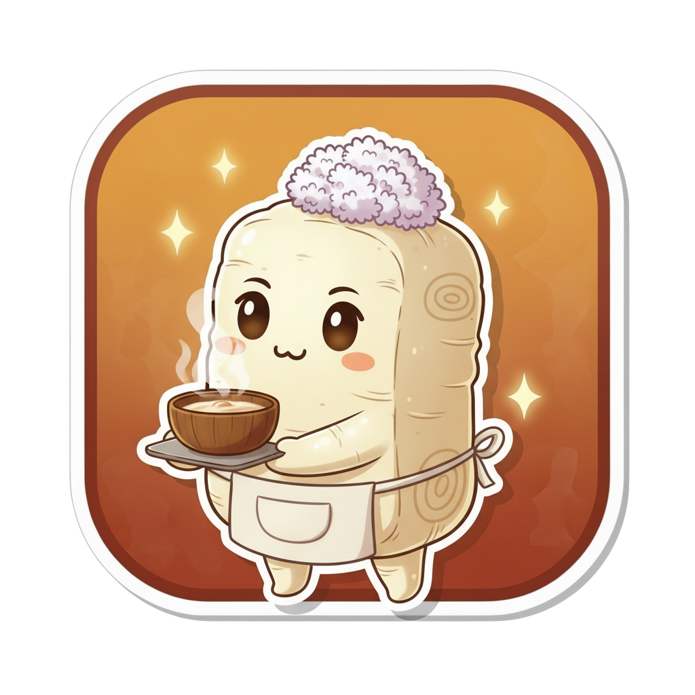

💊 **適用症狀**：肚子冷痛、拉稀甚至清晨一起床就要跑廁所、想吐或吐清水、手腳冷到過了手腕腳踝、怕冷到縮著、口不渴、口水清、整個人沒力、舌淡胖苔白滑、脈沉遲無力

> 📖 **方劑出處**：《太平惠民和劑局方》（宋代）——原名**附子理中丸**，就是張仲景的**理中湯**加一味**附子**；作湯劑時稱附子理中湯。
> 🏥 **方名含義**：**理中**還是「治理中焦」，前面冠上**附子**，意思很直接：中焦那把火，光靠乾薑已經點不著了，要請附子來。

---

## 📖 「我照上次的方子拿，為什麼沒用？」

小雪過後，新竹的風變成會鑽的那種。

承翰三十四歲，在竹科寫程式。他是十月那篇 **[理中湯](/stories/li-zhong-tang/)** 裡的主角——喝了五個月冰美式，寒露那週開始天天肚子悶痛、拉稀。中醫師說他肚子裡的電鍋開關沒按下去，開了理中湯，他戒了冰飲，兩個禮拜就好了。

好了兩個月。

小雪前後，公司年底專案進入最後衝刺。他連熬了兩個禮拜，每天一點睡、七點起，中間靠熱咖啡撐。冰的是真的沒喝了。

然後肚子又開始痛，而且**比十月那次更不對勁**：

- **肚子冷痛**，不是悶，是**像有一塊冰放在裡面**，熱水袋壓著才稍微好
- **每天早上一起床就要衝廁所**，拉出來稀稀水水的，有時候一天四五次
- **想吐**，早上刷牙會乾嘔，**吐出來是清水**
- **手腳冷**——十月是手指腳趾冷，現在**冷到手腕過去、冷到膝蓋**，摸小腿像摸水泥地
- **怕冷**，辦公室二十四度他穿羽絨背心，還是縮著
- **拉完會頭暈**，要在馬桶上坐一下才站得起來
- **早上起不來**，不是賴床，是**身體像沒電**，要在棉被裡縮半小時
- 完全**不渴**，口水清清的
- 舌頭自己照：**淡、胖、邊緣有齒痕，苔白白滑滑的**

他想，上次理中湯有效，就把舊的藥單拿去藥房，想再配一樣的。藥師看了看他的臉色，建議他還是回診。

中醫師看了舌、搭了脈——**脈沉、遲、按下去沒什麼力**。再按了按他的肚子，整個是涼的。又問他：「腳冷到哪裡？」

「膝蓋。」

「上次呢？」

「腳趾。」

中醫師點點頭：「上次我說你家電鍋的開關沒按下去。**這次開關是按下去了，可是你家一直跳電。**」

---

## 🩺 中醫師的診斷：不只脾陽虛，火已經虛到底下去了

「十月那次是**脾胃虛寒**——中焦那把火被冰美式澆小了，用理中湯把火點回來就好。」中醫師說，「這兩個月你沒喝冰的，但你**熬夜熬掉的是更底下的火**。」

「更底下？」

「中醫說脾是後天之本、腎是先天之本。**脾陽要靠腎陽來溫**——電鍋要有電，電是從總電源來的。你熬夜、過勞、年底又冷，把總電源也耗掉了。現在的情況是：**脾陽虛，而且腎陽也開始虛，陽虛到連中焦的火都點不穩。**」

他一項一項對回去：

- **肚子冷痛、拉稀、吐清水** = 中焦虛寒，這部分跟理中湯證一樣，但**更重**
- **清晨一起床就拉** = 清晨是一天陽氣最弱的時候，陽氣撐不住，寒就往下走
- **手腳冷「過了腕踝」** = 這是關鍵。中焦虛寒通常是手腳末端涼，**冷到過腕踝、到膝蓋，代表陽氣已經不夠送到四肢**，是腎陽虛、陽不達四末的訊號
- **拉完頭暈、早上起不來** = 陽氣虛衰，推不上去
- **脈沉遲無力** = 沉是陽在最底下，遲是火不夠、推得慢，無力是虛
- **舌淡胖齒痕苔白滑** = 寒、水、虛三樣都有

「所以上次的方子不夠？」

「**理中湯是一個電鍋。**乾薑負責加熱，人參供電，白朮收乾，甘草保溫。它處理的是**電鍋本身**。」中醫師在紙上畫了一個電鍋，「但現在不是電鍋的問題。**你家總電源的電壓不夠**，電鍋開關按下去，一下就跳掉。這時候再按一百次開關都沒用。」

「那要怎麼辦？」

「**先把總電源接回來。**」

> **理中湯** = 電鍋開關沒按下去（脾陽虛）
> → 按下去就好（乾薑溫中）
>
> **附子理中湯** = 開關按了，可是整戶一直跳電（脾腎陽虛）
> → 先把總電源接上（附子溫腎），電鍋才燒得起來（乾薑溫中）

---

## 🌿 從理中湯到附子理中丸：《局方》加的那一味

**理中湯**出自《傷寒論》，四味藥：人參、乾薑、白朮、炙甘草。

到了宋代，《太平惠民和劑局方》把它加了一味**附子**，做成丸，叫**附子理中丸**。原書說它治的是：

> 脾胃冷弱、心腹絞痛、嘔吐泄利、霍亂轉筋、體冷微汗、手足厥寒……飲食不進。

——注意這幾個字：**絞痛**（不是隱痛）、**霍亂轉筋**（上吐下瀉到抽筋）、**手足厥寒**（手腳冷到逆上來）。《局方》描述的是比理中湯證**更急、更重、更冷**的情況。承翰沒有到霍亂那麼嚴重，但他的「冷過膝蓋、拉完頭暈、吐清水」，方向就是這一條。

原方：**附子（炮，去皮臍）、人參、乾薑（炮）、甘草（炙）、白朮，各三兩**，研末蜜丸。

> 💡 **五味等量，但分工不同**
> 《局方》把五味藥寫成各三兩，但後世醫家普遍把**附子、乾薑**看成這帖方的雙君——一個溫腎、一個溫脾，**兩把火一起點**。
> 這是中醫很有名的一句話：「**附子無薑不熱，薑無附子不散。**」
> 乾薑**守而不走**，熱力留在中焦不動，像電鍋的加熱盤；附子**走而不守**，通行十二經，像總電源的電線，哪裡熄了就送到哪裡。
> **兩個人缺一個，火都點不穩。**

> 💡 **它跟 [真武湯](/stories/zhen-wu-tang/) 都有附子，差在哪？**
> 上週林阿公的真武湯，附子點火之後，剩下的藥全在**處理水**（茯苓、白朮、生薑、芍藥），因為阿公的問題是**水腫**。
> 附子理中湯點火之後，剩下的藥全在**補中焦的虛**（人參、白朮、甘草），因為承翰的問題是**拉稀、沒力**，**不腫**。
> 同一個人點火，後面跟的隊伍完全不同。

---

## 🎭 認識這五位隊員

五位，**零新角色**——四位是理中湯的老班底，再加上週剛登場的附子。整隊的分工是：**兩個點火、一個供電、一個收乾、一個保溫。**

### 第一組：雙君藥・接總電源＋加熱電鍋（兩位）

#### 附子（回陽急先鋒）

- **角色**：君藥・溫腎助陽、散寒止痛擔當
- **專長**：大辛、大熱，有毒。中藥裡**最熱的一味**，「走而不守，通行十二經」——哪裡的陽氣熄了，他就去哪裡點火。這一篇他負責的是**總電源**：把腎陽接回來，中焦的電鍋才有電可以燒。承翰那個「冷過膝蓋」，就是他要處理的
- **老朋友**：上週 **[真武湯](/stories/zhen-wu-tang/)** 裡他獨自當君藥、處理水腫；一月的 **[金匱腎氣丸](/stories/jin-kui-shen-qi-wan/)** 裡他用小劑量慢慢養。這一篇他跟乾薑並肩
- **他的脾氣**：**必須炮製**、**必須久煎**（通常先煎一小時以上）、劑量**嚴格由醫師決定**。生附子或煎煮不足會嘴唇發麻、心律不整，嚴重可致命。**這不是可以自己買、自己煮的藥**
- **口頭禪**：「總電源我接回來。電鍋，交給乾薑。」

#### 乾薑（暖爐戰士）

- **角色**：君藥・溫中祛寒擔當
- **專長**：大辛、大熱。**守而不走**，熱力留在脾胃不動，像電鍋底下的加熱盤。十月理中湯裡他一個人當君藥就夠了；這一篇火已經虛到底下去，**他需要附子在外面接電，他在裡面燒**。承翰的肚子冷痛、吐清水，是他顧的
- **老朋友**：**[理中湯](/stories/li-zhong-tang/)** 的君藥；**[小青龍湯](/stories/xiao-qing-long-tang/)** 裡他跟細辛、五味子組成「寒飲鐵三角」
- **口頭禪**：「有電了嗎？有的話，鍋我來燒。」

### 第二組：臣藥・發電廠

#### 人參（發電廠廠長）

- **角色**：臣藥・益氣補脾擔當
- **專長**：甘、微苦，微溫。**大補元氣**。火點著了，電鍋要有電一直供著；而且承翰拉了兩個禮拜，氣已經虛了——拉完頭暈、早上起不來，是氣虛。他負責**把電補回去**。有附子、乾薑在，他補的氣才能變成熱
- **老朋友**：**[理中湯](/stories/li-zhong-tang/)**、**[四君子湯](/stories/sijunzi-tang/)**、**[補中益氣湯](/stories/bu-zhong-yi-qi-tang/)** 都有他，一樣的位置
- **口頭禪**：「火點著了，電我來供。」

### 第三組：佐使藥・收乾與保溫（兩位）

#### 白朮（脾胃管家）

- **角色**：佐藥・健脾燥濕擔當
- **專長**：苦、甘，性溫。**健脾燥濕**。拉稀、吐清水、舌苔白滑——鍋裡都是水氣，他把它**收乾**，而且讓脾胃重新恢復運作，以後不再積
- **老朋友**：上週 **[真武湯](/stories/zhen-wu-tang/)** 的臣藥，今年所有「寒＋水」的方裡幾乎都有他
- **口頭禪**：「鍋燒起來了，水氣我收。」

#### 甘草（和事佬）

- **角色**：佐使藥・益氣和中、緩急止痛、調和諸藥擔當
- **專長**：甘，平；炙用後偏溫。他做三件事：**補中益氣**幫人參；**緩急止痛**，承翰那個像一塊冰在裡面的痛，他安撫；**調和**——附子、乾薑兩味大熱藥同場，他是中間那個緩衝，讓火燒得穩、不燥。另外他**能減附子的毒性**，是千年來附子配甘草的標準做法
- **口頭禪**：「兩位火太大了，我在中間守一下。」

> 💡 **五味藥，三件事**
> **點火**（附子接總電源、乾薑燒電鍋）、**供電**（人參）、**收乾＋保溫**（白朮、甘草）。
> 跟理中湯只差一味，但那一味決定了這帖方從「**暖肚子**」變成「**暖到底**」。

---

## ⚙️ 這支隊伍怎麼運作？接電、點火、供電、收乾

回到承翰家那個電鍋。

**十月的時候，電鍋開關沒按下去，米放一整天都不熟。按下去就好了。**

**現在開關按下去，電鍋亮一下，跳掉。再按，又跳。整戶的電壓不夠。**

> 🔥 **現場狀況**
> 🔥 總電源電壓不足 = 腎陽虛（冷過膝蓋、脈沉遲無力）
> 🔥 電鍋一直跳 = 脾陽虛（肚子冷痛、吐清水）
> 💧 米沒熟、鍋裡都是水 = 拉稀、舌苔白滑
> ⚡ 整戶沒電 = 沒力、頭暈、早上起不來

三種**不夠**的處理：

> ⚠️ **一直按電鍋開關**（只用理中湯）→ 乾薑在加熱，但總電源不夠，一下又跳掉；承翰自己拿舊藥單就是這個
> ⚠️ **只接總電源**（只用附子）→ 電來了，但電鍋本身也虛了，沒人燒、沒人收水，米還是不熟
> ⚠️ **吃止瀉藥**→ 把鍋蓋壓緊不讓水跑出來，火還是熄的

附子理中湯的處理順序：

> ⚡ **先把總電源接回來** → 附子
> 溫腎助陽，通行十二經，把陽氣送到四肢和中焦
>
> ↓
>
> 🔥 **電鍋重新加熱** → 乾薑
> 溫中祛寒，守在中焦，把那塊冰化掉
>
> ↓
>
> 🔋 **電一直供著** → 人參
> 大補元氣，把拉掉的、熬掉的氣補回來
>
> ↓
>
> 💧 **鍋裡的水收乾** → 白朮
> 健脾燥濕，拉稀、舌苔白滑由他處理
>
> ↓
>
> 🍵 **保溫鍵，兼守住火不燒過頭** → 甘草
> 緩急止痛、調和諸藥、減附子毒性

電回來了，鍋燒起來了，米熟了。

> ⚠️ **這帖方用了附子，和上週一樣，風險跟效果一樣真實。**
> 它只適合**虛寒**：怕冷、拉稀、脈沉遲、舌淡苔白。如果拉肚子是**吃壞東西**（急性腸胃炎，通常會發燒、拉的很臭）、是**濕熱**（拉的黏、肛門灼熱、舌苔黃膩）、或是**陰虛**（口乾、舌紅少苔），附子理中湯不但不對，還會把人燒壞。**拉肚子超過兩週、有血便、發燒、脫水——先看西醫。**

三週後回診，承翰的清晨腹瀉停了，腳冷退回腳踝，早上可以正常起床。

中醫師交代了幾件事：

- **附子的藥一定要照醫囑煎煮時間**，科學中藥照指示服用；**喝了嘴唇發麻、心跳怪怪的，立刻停藥就醫**
- **這帖方不會一直開**：拉稀止了、手腳暖回來，通常會**退回理中湯**，或轉成溫和的丸劑慢慢養
- **熬夜是這次的主因**，年底專案結束後要把睡眠補回來；**陽氣是在睡覺的時候長的**
- **冰的繼續戒**，溫熱的食物、熱湯；早餐一定要吃，而且要吃熱的
- **腰和腳保暖**，這次冷是從腎來的，腎在腰；睡覺穿襪子，泡腳可以
- 如果**清晨腹瀉一直反覆、好幾年**，而且伴隨腰痠、夜尿，那是另一個方向（腎虛的五更瀉），要再評估

「所以我是理中湯的病變嚴重了？」

「不是變嚴重。」中醫師說，「**是你把火從電鍋熬到總電源去了。**」

---

## 📊 四帖「怕冷」的方，看火熄在哪一層

### 從電鍋到總電源

| 方劑 | 火熄在哪 | 關鍵辨點 |
|------|------|----------|
| **[理中湯](/stories/li-zhong-tang/)** | 中焦（脾陽虛） | 肚子悶痛、便溏、口水多，**手腳只有末端涼**，不暈 |
| **附子理中湯** | 中焦＋下焦（脾腎陽虛） | 肚子**冷痛**、**清晨瀉**、吐清水，**冷過腕踝**、拉完頭暈、脈沉遲無力 |
| **[真武湯](/stories/zhen-wu-tang/)** | 下焦（腎陽虛、水泛） | 怕冷**加上腳腫、尿少、頭暈心悸**，重點在水 |
| **[金匱腎氣丸](/stories/jin-kui-shen-qi-wan/)** | 下焦（腎陽虛、慢性） | 腰冷、夜尿多，慢慢虛，**用小火慢養的丸劑** |

> 理中湯是電鍋；附子理中湯是電鍋＋總電源；真武湯是鍋爐熄了、地下室淹水；腎氣丸是平時養鍋爐。

### 乾薑和附子，兩把不一樣的火

| | 乾薑 | 附子 |
|------|------|------|
| **走向** | 守而不走，留在中焦 | 走而不守，通行十二經 |
| **擅長** | 肚子冷、吐清水、拉稀 | 全身冷、四肢厥逆、脈微 |
| **比喻** | 電鍋的加熱盤 | 總電源的電線 |
| **毒性** | 無，但大辛大熱，陰虛者不宜 | 有，必須炮製久煎，醫師控制劑量 |

> 「附子無薑不熱，薑無附子不散」——兩味常常一起出現，但各做各的事。

---

## ❓ 常見問題 Q&A

**Q1：我上次吃理中湯有效，這次自己去配一樣的可以嗎？**
**不建議。**承翰就是這樣，藥師看了臉色請他回診。同樣是「怕冷拉肚子」，**冷到哪裡、拉的樣子、有沒有頭暈**，決定了方劑要不要調整。而且附子理中湯含附子，**根本不是可以自己配的藥**。症狀一樣，體質的層次可能已經不一樣。

**Q2：附子理中湯和理中湯，自己怎麼初步分？**
看三件事：**手腳冷到哪裡**（末端涼 vs 冷過腕踝、到膝蓋）、**拉肚子的時間**（整天隨機 vs 清晨一起床就拉）、**有沒有頭暈沒力**（還撐得住 vs 拉完要坐一下）。前者偏理中湯，後者偏附子理中湯。但這只是初步判斷，**附子要不要用、用多少，由醫師決定**。

**Q3：「附子無薑不熱」是什麼意思？**
附子走而不守、通行全身，熱力散得快；乾薑守而不走、熱力留在中焦不動。兩個一起用，**附子把熱送到各處、乾薑把熱留住**，火才燒得穩。單用附子，熱一下就散了；單用乾薑，熱出不了中焦。所以溫陽的方裡常常兩個一起出現——四逆湯、附子理中湯都是。

**Q4：附子有毒，為什麼這麼多方都用？**
附子的毒來自烏頭鹼，但**炮製**（鹽、膽巴浸泡再蒸煮）和**久煎**（先煎一小時以上）可以把它大幅降解，剩下的正是溫陽的主力。再加上配甘草可以減毒。所以「炮附子＋久煎＋醫師控制劑量＋配甘草」是千年的安全做法。**危險的從來不是附子，而是生附子、煎不夠久、或自己加量。**

**Q5：清晨拉肚子就是這一型嗎？**
不一定。清晨腹瀉（五更瀉）有兩個常見方向：一個是**脾腎陽虛**像承翰，用附子理中湯這類；另一個是**腎陽虛為主、長期反覆好幾年**，伴腰痠、夜尿，會用四神丸這類固澀的方。還有，**清晨腹瀉也可能是腸躁症、甲狀腺問題、慢性腸道發炎**，拉超過兩週或有血便，**先看腸胃科**。

**Q6：這帖方可以吃多久？**
**不長期吃原方。**它是處理「寒到底了」的階段方，手腳暖回來、拉稀止了，通常會**退回理中湯**，或轉成溫和的丸劑。承翰三週就調整了。附子不宜久服，什麼時候退、怎麼退，由醫師判斷。

**Q7：什麼情況要先看西醫？**
**拉肚子超過兩週**、**血便或黑便**、**發燒**、**脫水**（尿很少、嘴唇乾、站起來眼前發黑）、**體重明顯掉**、**半夜痛醒**——這些要先排除感染、發炎性腸道疾病、甲狀腺功能、腸道腫瘤。**服用附子後嘴唇舌頭發麻、噁心、心悸、心律不整**，立即就醫。

---

## ✅ 「脾腎陽虛型」怕冷拉稀小自測

最近的你，中了幾項？

- [ ] 肚子**冷痛**，像有一塊冰在裡面，熱敷會好一點
- [ ] **清晨一起床**就要跑廁所，拉出來稀稀水水
- [ ] 想吐，吐出來是**清水**
- [ ] 手腳冷**過了手腕腳踝**，甚至到膝蓋
- [ ] **怕冷**到縮著，別人穿一件你穿三件
- [ ] **拉完會頭暈**，要坐一下
- [ ] 早上**起不來**，不是想睡，是沒電
- [ ] **不渴**、口水清
- [ ] 整個人**沒力**、不想動
- [ ] 照鏡子看舌頭：**舌淡、胖、有齒痕、苔白滑**

> 中 6 項以上可能偏向這一型，但**拉肚子超過兩週、血便、發燒，請先到腸胃科或家醫科檢查**。**本方含附子，絕對不可自行購買服用。**

---

## ⚠️ 安全提醒

- 本文為中醫知識分享，**不能取代專業診斷與處方**。本方含**附子**，**絕對不建議自行抓藥、購買或服用**，即使之前吃過理中湯有效也一樣。
- **⚠️ 腹瀉請先排除以下狀況**：**急性腸胃炎、食物中毒、發炎性腸道疾病、甲狀腺功能亢進、腸道腫瘤、藥物副作用**。
- **⚠️ 出現以下任一情況，請立即就醫**：
  > **血便、黑便**
  > **發燒合併腹瀉**
  > **脫水**（尿量很少、嘴唇乾裂、站起來眼前發黑）
  > **劇烈腹痛、半夜痛醒**
  > **服藥後嘴唇舌頭發麻、噁心、心悸、心律不整**（附子中毒警訊）
- **附子**：必須使用**炮製品**，必須**久煎**（通常先煎一小時以上），劑量**嚴格由醫師決定**；生附子有劇毒。
- 本方**大熱**，以下情況**不適用**：**濕熱瀉**（拉的黏、肛門灼熱、舌苔黃膩）、**急性腸胃炎**（發燒、拉的很臭）、**陰虛**（口乾、舌紅少苔、潮熱盜汗）、**實熱證**。
- 正在服用**強心劑（毛地黃類）、抗心律不整藥、降血壓藥**者，請務必告知中醫師，**附子與這些藥物可能有交互作用**；**不要自行停用西藥**。
- **孕婦禁用**；哺乳期、幼兒、年長者、慢性病患者使用前務必諮詢合格中醫師。

---

## 🔗 系列連結

- 回顧 **[理中湯](/stories/li-zhong-tang/)**：承翰十月那一篇——電鍋開關沒按下去；這一篇是開關按了、總電源不夠
- 回顧 **[真武湯](/stories/zhen-wu-tang/)**：上週林阿公——同樣是附子點火，後面跟的是抽水隊；這週跟的是補虛隊
- 回顧 **[金匱腎氣丸](/stories/jin-kui-shen-qi-wan/)**：附子第一次登場、小火慢養；附子理中湯退場之後，有時會轉去用它
- 回顧 **[當歸四逆湯](/stories/dang-gui-si-ni-tang/)**：同樣手腳冷，那是血虛、末端結冰；這是陽虛、總電源不夠
- 回顧 **[小青龍湯](/stories/xiao-qing-long-tang/)**：乾薑在那裡燒的是肺裡的水；這一篇他燒的是肚子
- 系列彩蛋：承翰好了。但他回家那天，發現太太佳蓉正抱著熱水袋縮在沙發上——她每個月都這樣，只是以前沒說。下週，這帖不是藥方，是一鍋湯 🌿

---

> 「開關按下去了，
> 可是一直跳電。
> 不是電鍋壞了，
> 是總電源不夠。
> 所以先把電接回來，
> 再把鍋燒熱，
> 把電一直供著，
> 把水收乾。
> 然後，
> 把那塊冰，
> 慢慢化掉。」
