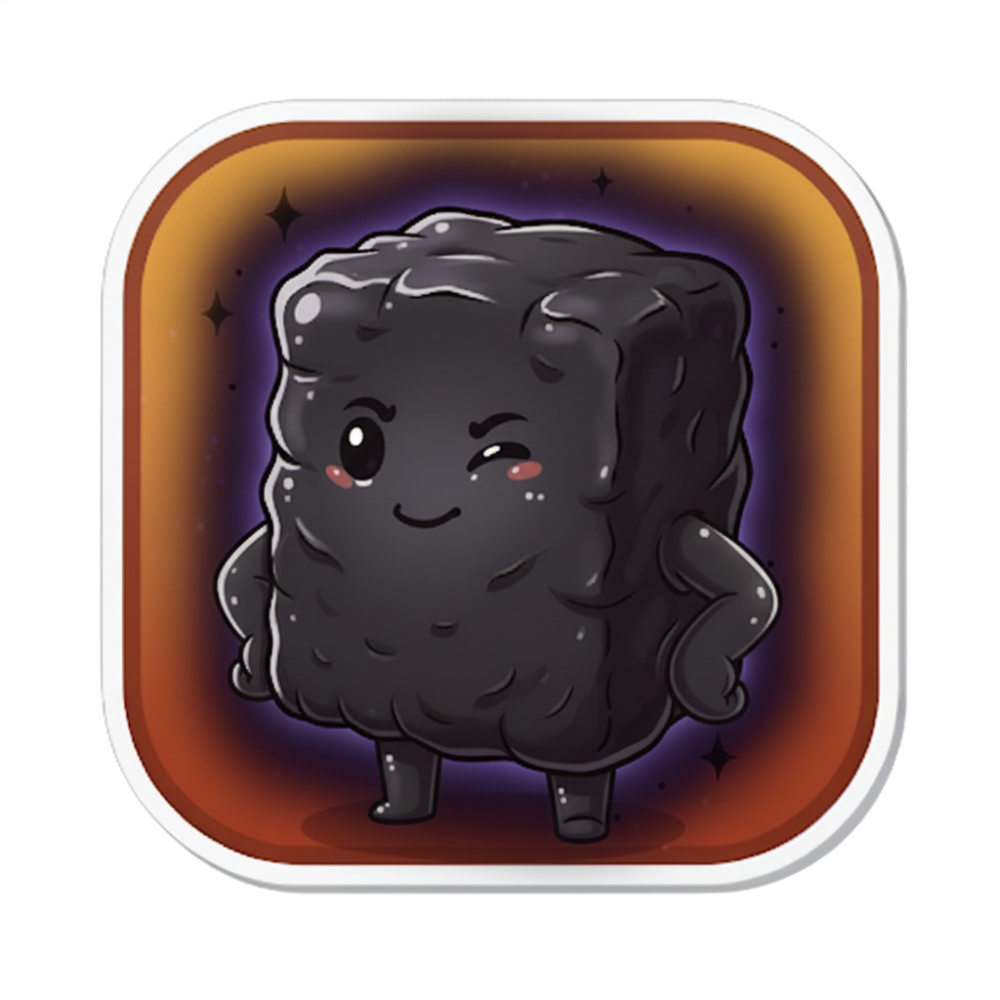

💊 **適用症狀**：腰膝酸軟冷痛、怕冷手腳冰、精神差容易累、夜尿多、白天打瞌睡、腿沒力走不遠、久病不復、男子性功能減退、女子月經量少宮寒、舌淡苔白、脈沉遲

> 📖 **方劑出處**：《景岳全書》（明代・張介賓／張景岳）——為「**元陽不足、命門火衰**」所立的溫補大方。
> 🏥 **方名含義**：**右歸**——張景岳認為「左腎為水、右腎為命門之火」，這帖方的藥力**歸於右腎命門**，補的是火；跟它對應的「**左歸丸**」歸於左腎，補的是水。一左一右，一陰一陽。

---

## 📖 「水退了，可是阿公還是冷」

大雪那天，彰化的清晨八度。

林阿公七十一歲，三週前是 **[真武湯](/stories/zhen-wu-tang/)** 裡腳腫到拖鞋穿不下的那位。真武湯喝了三週，**腳消了**，三件毛衣變兩件，站起來不用扶桌子，半夜腳也不抽了。

美惠帶他回診。中醫師看了腳，按了一下，不凹了。

「水退了。」他說，「接下來換另一件事。」

因為阿公雖然不腫了，但人還是「**沉**」，而且換了一種沉：

- **怕冷**，還是怕，但不是之前那種整棟樓冷，是**從腰和膝蓋冷出來**
- **腰酸、腰冷**，阿公說「腰像沒了支架」，坐久站起來要扶一下
- **膝蓋酸軟沒力**，走到巷口還是想坐
- **夜尿三四次**，尿色淡，量不多，每次起來都睡不回去
- **白天精神差**，看電視坐著就打瞌睡
- **胃口還可以，不拉了**，這點比之前好
- 不腫、不暈、不心悸了
- 舌還是**淡、苔白**，但齒痕淺了；脈還是**沉**，但沒那麼細，變成**遲**

「水不是退了嗎？為什麼還這樣？」美惠問。

「水是抽乾了。」中醫師說，「可是妳想想，鍋爐為什麼會熄？」

「……火不夠？」

「對。真武湯那三週，我們做的事是**點一把火、把水抽掉**——那是急救。現在水抽完了，但**鍋爐本身還是舊的、煤也沒有**。整個冬天還很長，光靠那一把火撐不過去。」

他一邊寫方，一邊注意到旁邊陪診的阿嬤——六十八歲，一直安靜坐著，**一隻手按在胸口**，偶爾深吸一口氣。

「阿嬤，妳還好嗎？」

「沒事沒事，老毛病。」

中醫師看了她一眼，沒多說，先把阿公的方寫完。

---

## 🩺 中醫師的診斷：腎陽虛，而且精也虛了

「阿公現在是**腎陽不足、命門火衰**。」

「跟真武湯那時候差在哪？」

「真武湯那時候是**腎陽虛，而且水淹上來**——急性的，重點在水。現在水沒了，剩下的是**慢性的虛**：火不夠（怕冷、腰冷、夜尿多），而且**精也不夠**（腰膝沒力、精神差、久病）。中醫說『**腎藏精**』，精是鍋爐的煤，是燃料。阿公做了四十年水電，年輕時耗的，現在一次還。」

他一項一項對回去：

- **腰冷、腰酸** = 腰為腎之府，腎陽虛、精虧，腰最先沒支撐
- **膝蓋酸軟、腿沒力** = 腎主骨，精不足，骨頭沒有養
- **夜尿多、尿色淡** = 腎陽虛，膀胱沒有熱可以固攝（跟之前的「尿少」剛好相反——之前是水排不出去，現在是水關不住）
- **怕冷** = 命門火衰，整個身體的熱源弱
- **白天打瞌睡、精神差** = 陽虛不能鼓舞精神
- **脈沉遲** = 沉是陽在底下，遲是火不夠、推得慢

「那要怎麼辦？」

「**真武湯要停了，換成慢的、補的。**」中醫師說，「有兩條路：一條是 **[金匱腎氣丸](/stories/jin-kui-shen-qi-wan/)**，小火慢養，一邊補一邊排，適合虛得不嚴重的。但阿公七十一歲、剛淹過水、精神這麼差，**要補得更重一點**——右歸丸。」

> **真武湯** = 鍋爐熄了、地下室淹水 → **點火、抽水**（急救，三週）
> **右歸丸** = 水抽乾了、鍋爐舊、沒煤 → **修鍋爐、加煤、顧火**（整個冬天）

---

## 🌿 張景岳的「陰中求陽」

右歸丸出自明代張景岳的《景岳全書》。

張景岳是中醫史上有名的「**溫補派**」——他認為人身的陽氣是最珍貴的，「**陽非有餘**」，所以用藥偏溫、偏補。右歸丸是他溫補腎陽的代表作。

它的來路是這樣的：

> **[六味地黃丸](/stories/liu-wei-di-huang-wan/)**（三補三瀉，滋腎陰）
> → 加附子、肉桂 = **[金匱腎氣丸](/stories/jin-kui-shen-qi-wan/)**（陰中求陽，小火）
> → **拿掉三瀉**（澤瀉、牡丹皮、茯苓），**加鹿角膠、菟絲子、杜仲、枸杞、當歸** = **右歸丸**（純補不瀉，大火）

張景岳說了一句話，是這帖方的核心：

> 「**善補陽者，必於陰中求陽，則陽得陰助而生化無窮。**」

——要補火，不能只放火。**要先有煤（陰、精），火才燒得起來、燒得久。**所以右歸丸裡，真正溫陽的藥只有附子、肉桂、鹿角膠三味；剩下七味，大半在**填精、補陰、補血**——那些才是煤。

原方：**熟地黃八兩、山藥四兩、山茱萸三兩、枸杞四兩、菟絲子四兩、鹿角膠四兩、杜仲四兩、肉桂二兩（漸加至四兩）、當歸三兩、製附子二兩（漸加至五六兩）**，蜜丸。

> 💡 **「漸加」兩個字**
> 景岳在附子、肉桂後面寫「漸加」——**從小量開始，慢慢加上去**。
> 這跟真武湯「附子一枚」是同一個思路：**虛的人經不起猛火**。丸劑本來就慢，再加上漸加，是要讓火一點一點大起來，不是一下燒旺。

> 💡 **為什麼把三瀉拿掉？**
> 六味地黃丸、腎氣丸裡的澤瀉、丹皮、茯苓，是「**補的時候順便排一點**」——怕補太膩、怕有濕熱。
> 但阿公剛被真武湯抽過水、利過尿，**不需要再排了**；他需要的是**全部留下來**。所以景岳把三瀉拿掉，換成四味純補的藥。
> **腎氣丸是「邊補邊排」，右歸丸是「只補不排」**——用哪個，看虛到什麼程度、有沒有濕。

---

## 🎭 認識這十位隊員

十位，六位老朋友、**四位新角色**——鹿角膠、菟絲子、杜仲、枸杞子，全是補腎的常客，今年終於一起登場。整隊的分工是：**三個點火、六個加煤、一個讓煤流動。**

### 第一組：君藥・點火（三位）

#### 附子（回陽急先鋒）

- **角色**：君藥・溫腎助陽擔當
- **專長**：大辛、大熱，有毒。鍋爐的**火種**。這是他連續第三週登場——真武湯裡獨自點火、附子理中湯裡跟乾薑並肩、這一篇他退回「漸加」的小劑量，**跟肉桂、鹿角膠一起，把火穩穩留在腎裡**
- **他的脾氣**：**炮製、久煎、劑量由醫師決定**。丸劑裡的附子已經炮過、劑量固定，但**仍然不是可以自己買的藥**
- **口頭禪**：「這次我不衝了。火種放這裡，慢慢燒。」

#### 肉桂（暖爐點火官）

- **角色**：君藥・補火助陽、引火歸元擔當
- **專長**：辛、甘，大熱。跟附子的差別：附子**走**，通行全身；肉桂**守**，而且會「**引火歸元**」——把浮上來的火**收回腎裡**。阿公那種白天打瞌睡、晚上又睡不好，有一部分是火沒有歸位，他負責把火帶回鍋爐
- **老朋友**：**[金匱腎氣丸](/stories/jin-kui-shen-qi-wan/)** 裡跟附子並肩；**[十全大補湯](/stories/shi-quan-da-bu-tang/)** 裡他是十位裡唯一的溫陽藥
- **口頭禪**：「火不要亂跑，回鍋爐裡來。」

#### 鹿角膠（修鍋爐的人）★ 新角色

- **角色**：君藥・溫腎壯陽、益精養血擔當
- **專長**：甘、鹹，性溫。鹿角熬成的膠，跟上週的羊肉一樣是「**血肉有情之品**」。他跟附子、肉桂不同：附子肉桂是**火**，他是**連鍋爐本體一起補**——溫陽的同時**填精養血**。張景岳特別看重他，因為「陰中求陽」要的就是這種**陽裡帶陰**的藥
- **他的脾氣**：性溫，**陰虛火旺**（口乾舌紅、潮熱）的人不適合；**動物製品**，吃素的要跟醫師討論替代
- **口頭禪**：「火要點，鍋爐也要修。我兩邊都顧。」

### 第二組：臣藥・加煤（六位）

#### 熟地黃（滋陰補腎總管）

- **角色**：臣藥・滋陰補血、益精填髓擔當
- **專長**：甘，微溫。**全方用量最重**，八兩。他是鍋爐裡的**煤**——沒有他，附子、肉桂的火燒不了多久。「陰中求陽」的「陰」，主要就是他
- **老朋友**：**[六味地黃丸](/stories/liu-wei-di-huang-wan/)**、**[金匱腎氣丸](/stories/jin-kui-shen-qi-wan/)** 的君藥，今年所有補腎的方他都在
- **他的脾氣**：**滋膩**，脾胃虛弱、消化差的人要配健脾藥；阿公不拉了才能用他
- **口頭禪**：「煤我來堆。整個冬天的量。」

#### 山藥（補脾固腎的人）

- **角色**：臣藥・補脾益腎、固精擔當
- **專長**：甘，平。他**同時補脾和腎**——煤要有人搬進鍋爐，脾就是搬煤的人。而且他能**固**，讓補進去的不要漏
- **口頭禪**：「煤搬進來了，我負責不讓它掉出去。」

#### 山茱萸（收斂守門員）

- **角色**：臣藥・補益肝腎、澀精固脫擔當
- **專長**：酸，微溫。**補中帶澀**——阿公夜尿多，是腎關不住水；他把門守住。跟山藥一起，是地黃丸家族的「**三補**」裡的兩位
- **口頭禪**：「門我守著。補進來的，一滴不漏。」

#### 枸杞子（紅色小燈籠）★ 新角色

- **角色**：臣藥・滋補肝腎、益精明目擔當
- **專長**：甘，平。大家最熟的補腎藥，泡茶、煮湯都看得到。性平，**陰陽都補一點**，所以左歸丸、右歸丸兩邊他都在。阿公看電視打瞌睡、眼睛也容易花，是他顧
- **他的脾氣**：性平，**外感發燒、脾虛便溏**的時候暫停
- **口頭禪**：「我左邊也補、右邊也補，不挑邊。」

#### 菟絲子（攀著走的人）★ 新角色

- **角色**：臣藥・補腎益精、固精縮尿擔當
- **專長**：辛、甘，平。菟絲子是一種攀在別的植物上生長的藤的種子，中醫說它「**平補陰陽**」——不偏溫也不偏涼，補腎而不燥。而且他能**縮尿**：阿公晚上起來三四次，他和山茱萸一起把膀胱的門關緊
- **他的脾氣**：性平，很好相處；但**陰虛火旺、便秘**的人注意
- **口頭禪**：「我攀著大家一起走。晚上的廁所，少跑幾趟。」

#### 杜仲（腰的支架）★ 新角色

- **角色**：臣藥・補肝腎、強筋骨擔當
- **專長**：甘，溫。杜仲是樹皮，折斷的時候會拉出**白色的絲**——古人覺得像筋，所以用它**強筋骨**。阿公說「腰像沒了支架」，杜仲就是那個支架：**補肝腎、強腰膝**，是中醫治腰酸最常用的藥之一
- **他的脾氣**：性溫，**陰虛火旺**的人慎用
- **口頭禪**：「腰我撐著。先站得直，再走得遠。」

### 第三組：佐藥・讓煤流動

#### 當歸（調度二姐）

- **角色**：佐藥・養血和血擔當
- **專長**：甘、辛，溫。十味藥裡九味在補，補多了會**滯**——她負責讓血動起來，補進去的東西才送得到腰、膝、腳。上週她在羊肉湯裡當君藥；這一篇她是配角，但少了她整帖方會太「悶」
- **口頭禪**：「補進來的，我負責送出去。」

> 💡 **十味藥，三件事**
> **點火**（附子、肉桂、鹿角膠）、**加煤**（熟地、山藥、山茱萸、枸杞、菟絲子、杜仲）、**流動**（當歸）。
> 火只佔三成，煤佔六成——這就是「**陰中求陽**」：**先有燃料，火才燒得久。**

---

## ⚙️ 這支隊伍怎麼運作？修鍋爐、加煤、顧火

回到那棟樓。

**三週前鍋爐熄了、地下室淹水，真武湯點了一把火、把水抽乾了。**

**現在地板乾了。但走到鍋爐房一看：鍋爐的鋼板鏽了、煤倉是空的、那一把火快燒完了。外面還有兩個月的冬天。**

> 🏚️ **現場狀況**
> 🔥 火快燒完 = 命門火衰（怕冷、腰冷、脈沉遲）
> 🪨 煤倉空了 = 腎精不足（腰膝沒力、精神差、久病）
> 🔧 鍋爐鏽了 = 腎陽虛日久（夜尿多、關不住）

三種**不夠**的處理：

> ⚠️ **繼續喝真武湯**→ 它是抽水隊，水抽完了還一直抽，人會越抽越乾
> ⚠️ **只用附子、肉桂猛燒**（純陽藥）→ 煤倉是空的，火再大也燒不了多久，而且會燒傷鍋爐（傷陰）
> ⚠️ **只補陰不溫陽**（只用六味地黃丸）→ 煤堆滿了，可是沒有火，煤放在那裡是冷的

右歸丸的處理順序：

> 🔧 **先修鍋爐本體** → 鹿角膠
> 溫陽又填精，血肉有情，鋼板補好
>
> ↓
>
> 🪨 **把煤倉堆滿** → 熟地、山藥、山茱萸、枸杞、菟絲子、杜仲
> 填精、補陰、補血、強筋骨，整個冬天的燃料
>
> ↓
>
> 🔥 **火種放進去，漸加** → 附子、肉桂
> 從小火開始，慢慢加大；肉桂把火留在鍋爐裡不亂跑
>
> ↓
>
> 🚪 **把門關好** → 山茱萸、菟絲子、山藥
> 固精縮尿，補進去的不漏掉，晚上少起來
>
> ↓
>
> 🚚 **煤要送到每一層** → 當歸
> 養血和血，腰、膝、腳都要有

鍋爐修好了、煤堆滿了、火穩穩燒著——這個冬天撐得過去。

> ⚠️ **這帖方含附子、肉桂、鹿角膠，是「大補」的方。**
> 它只適合**真的虛、真的寒**的人：怕冷、腰冷、夜尿多、脈沉遲。如果是**陰虛火旺**（口乾、舌紅、潮熱、手腳心熱）、**濕熱**（口苦、小便黃、舌苔黃膩）、或是**感冒中**，補下去會「**閉門留寇**」，把病關在裡面。**夜尿多的長輩，也要先排除攝護腺和血糖的問題。**

一個半月後，過完冬至、快到小寒，阿公回診。腰不那麼冷了，夜尿減到一兩次，白天看電視不打瞌睡了，可以自己走到市場。

中醫師交代了幾件事：

- **丸劑慢，要吃一段時間**，通常以月計，不是以週計；**什麼時候停、什麼時候減量，由醫師判斷**
- **心臟科、腎臟科的追蹤不要停**，阿公之前腫過，這是長期要看的
- **夜尿如果一直三四次以上、或是尿不乾淨、尿流變細**，去**泌尿科**看攝護腺；**夜尿多又口渴、吃多**，去查血糖
- **感冒的時候停藥**，等好了再繼續
- **吃了嘴破、便秘、睡不著、血壓升高**，表示太溫了，回診調整
- **腰和腳保暖**，陽氣從下面養；**晚上七點後少喝水**，減少夜尿
- **飲食溫熱，少生冷**；瓜果少吃；可以吃一點**黑豆、核桃、黑芝麻**這類平補的食物
- **走路**，每天走到巷口、再走到市場，腿要用才會有力

「所以阿公要一直吃這個？」

「吃到春天。」中醫師說，「**冬天是養腎的季節**，這個冬天把煤堆好，明年春天鍋爐自己會燒。」

然後他轉頭看阿嬤：「阿嬤，妳那個胸口，下禮拜來給我看一下。」

---

## 📊 地黃丸家族，從補水到補火

### 四帖地黃丸，一路往「火」的方向走

| 方劑 | 補什麼 | 有沒有「瀉」 | 關鍵辨點 |
|------|------|------|----------|
| **[六味地黃丸](/stories/liu-wei-di-huang-wan/)** | 腎陰 | 三補三瀉 | **口乾、潮熱、手腳心熱**、舌紅少苔——怕熱 |
| **[金匱腎氣丸](/stories/jin-kui-shen-qi-wan/)** | 腎陰為主，微溫腎陽 | 三補三瀉＋小火 | 腰冷、夜尿、**輕度**怕冷，虛得不嚴重 |
| **右歸丸** | 腎陽＋腎精 | **純補不瀉** | **怕冷明顯、腰膝冷痛沒力、精神差、久病**——虛得重 |
| 左歸丸（未寫） | 腎陰＋腎精 | 純補不瀉 | 跟右歸丸對應，陰虛重的用 |

> 同一個熟地黃當底，往陰走是六味、左歸；往陽走是腎氣丸、右歸。**腎氣丸和右歸丸的差別是「虛的程度」和「要不要排」。**

### 真武湯 → 右歸丸：急救到調養

| | **[真武湯](/stories/zhen-wu-tang/)** | **右歸丸** |
|------|------|------|
| **階段** | 急性期（水淹上來） | 恢復期（水退了、人虛） |
| **劑型** | 湯，快 | 丸，慢 |
| **重點** | 抽水 | 加煤 |
| **附子** | 一枚，點火 | 漸加，顧火 |
| **療程** | 幾週 | 幾個月，常常一整個冬天 |

> 阿公這兩篇，就是中醫「**急則治其標，緩則治其本**」最標準的示範。

---

## ❓ 常見問題 Q&A

**Q1：右歸丸和金匱腎氣丸都是溫補腎陽，怎麼分？**
看**虛的程度**和**有沒有濕**。腎氣丸保留了三瀉（澤瀉、丹皮、茯苓），**邊補邊排**，溫陽藥量小，適合**虛得輕、或還有一點水濕**的人；右歸丸拿掉三瀉、加鹿角膠、菟絲子、杜仲、枸杞，**純補不排**，適合**虛得重、精也虧、沒有濕**的人。阿公剛被真武湯抽過水，不需要再排，而且七十一歲久病，所以用右歸丸。

**Q2：「陰中求陽」是什麼意思？**
張景岳的名言：「善補陽者，必於陰中求陽，則陽得陰助而生化無窮。」意思是**補火之前要先有燃料**——陰、精是燃料。所以右歸丸雖然叫「溫補腎陽」，十味藥裡真正溫陽的只有三味，其他七味大半在填精補陰。純用附子肉桂猛燒，煤倉空的，火一下就滅，還會燒壞鍋爐。

**Q3：右歸丸可以自己買來補嗎？**
**不建議。**它含附子、肉桂、鹿角膠，是大補大溫的方。**陰虛火旺**（口乾舌紅、潮熱盜汗、手腳心熱）、**濕熱**（口苦、小便黃、舌苔黃膩）、**感冒中**、**高血壓控制不好**的人吃了會出問題。「怕冷、腰酸」很多原因都會，不一定是腎陽虛。讓中醫師看過舌脈再決定。

**Q4：夜尿多就是腎陽虛嗎？**
不一定。**男性**夜尿多最常見的原因是**攝護腺肥大**；**糖尿病**初期也常夜尿多又口渴；**膀胱過動症**、**睡眠呼吸中止**、**心衰竭**、**利尿劑**也都會。阿公是心腎都檢查過之後，中醫才處理「腎陽虛」這一層。**夜尿三次以上、尿不乾淨、尿流變細，先看泌尿科。**

**Q5：丸劑要吃多久？**
丸劑的設計就是**慢慢補**，通常以**月**計。腎陽虛、精虧是長年累積的，一個冬天補回來是合理的期待。但**不是一直吃**——陽氣回來、夜尿減少、精神好了，醫師會減量或換方。**吃了嘴破、便秘、睡不著、血壓升高**，表示補過頭，要回診。

**Q6：鹿角膠是動物製品，吃素的怎麼辦？**
鹿角膠是鹿角熬的膠，素食者不能用。可以跟醫師討論**減去鹿角膠**或改用其他補腎陽的藥（例如加重菟絲子、杜仲，或用巴戟天、仙靈脾這類）。效果方向一樣，力道會弱一些。

**Q7：什麼情況要先看西醫？**
**夜尿三次以上、尿流變細、尿不乾淨**（泌尿科，攝護腺）；**夜尿多又口渴、體重掉**（新陳代謝科，血糖）；**腰痛是單側、或痛到腿麻**（骨科、神經科）；**腳又腫起來**（回心臟科）；**精神差到嗜睡、記憶力明顯退化**（神經科）。**服藥後心悸、嘴唇發麻、血壓升高**，立即就醫。

---

## ✅ 「腎陽虛、命門火衰型」小自測

最近的你或家裡的長輩，中了幾項？

- [ ] **怕冷**，尤其**腰和膝蓋**冷出來
- [ ] **腰酸、腰冷**，坐久站起來要扶
- [ ] **膝蓋酸軟**，走不遠就想坐
- [ ] **夜尿兩次以上**，尿色淡
- [ ] **白天精神差**，坐著就打瞌睡
- [ ] 整個人**沒力**、容易累
- [ ] 手腳冰
- [ ] 男性**性功能減退**，女性**月經量少、小腹冷**
- [ ] **不口渴**，喜歡熱的
- [ ] 照鏡子看舌頭：**舌淡、苔白**

> 中 6 項以上可能偏向這一型。但**夜尿多的長輩請先到泌尿科或家醫科檢查**，排除攝護腺、血糖的問題。**本方含附子、肉桂，不可自行購買服用。**

---

## ⚠️ 安全提醒

- 本文為中醫知識分享，**不能取代專業診斷與處方**。本方含**附子、肉桂、鹿角膠**，是大補大溫的方，**絕對不建議自行購買服用**。
- **⚠️ 夜尿頻多請先就診**，排除：**攝護腺肥大、糖尿病、膀胱過動症、睡眠呼吸中止、心臟衰竭、利尿劑副作用**。
- **⚠️ 出現以下任一情況，請立即就醫**：
  > **尿不出來、血尿**
  > **腳再度水腫、躺平就喘**
  > **服藥後心悸、血壓明顯升高、嘴唇舌頭發麻**
  > **精神差到嗜睡、意識不清**
- 本方**大溫大補**，以下情況**不適用**：**陰虛火旺**（口乾、舌紅少苔、潮熱盜汗、手腳心熱）、**濕熱**（口苦、小便黃、舌苔黃膩）、**實熱證**、**感冒發燒期間**、**高血壓控制不良**者。
- **熟地黃滋膩**，脾胃虛弱、腹瀉、消化不良者需配合健脾藥或暫緩。
- 正在服用**降血壓藥、強心劑、抗凝血藥**者，請告知中醫師；**不要自行停用西藥**。
- **孕婦**使用前務必諮詢醫師；哺乳期、慢性病患者使用前請諮詢合格中醫師。

---

## 🔗 系列連結

- 回顧 **[真武湯](/stories/zhen-wu-tang/)**：三週前的阿公——點火、抽水；這一篇是水退了之後，修鍋爐、加煤
- 回顧 **[金匱腎氣丸](/stories/jin-kui-shen-qi-wan/)**：同樣溫補腎陽，那是邊補邊排的小火；這是純補不排的大火
- 回顧 **[六味地黃丸](/stories/liu-wei-di-huang-wan/)**：地黃丸家族的原點，往陰走；右歸丸往陽走
- 回顧 **[附子理中湯](/stories/fu-zi-li-zhong-tang/)**：兩週前的承翰——同樣附子，那是接總電源救急；這是放火種慢燒
- 回顧 **[當歸生薑羊肉湯](/stories/dang-gui-sheng-jiang-yang-rou-tang/)**：上週的羊肉、這週的鹿角膠，都是「血肉有情之品」
- 系列彩蛋：阿公的冬天安排好了。下週，換那位一直按著胸口的阿嬤——冬至前三天，一帖叫「復脈」的方 🌿

---

> 「水抽乾了，
> 可是整個冬天還很長。
> 鍋爐鏽了，煤倉空了，
> 那一把火快燒完了。
> 所以先修鍋爐，
> 再把煤堆滿，
> 然後放一個火種——
> 從小火開始。
> 火只佔三成，
> 煤佔六成。
> 先有燃料，
> 火才燒得久。」
